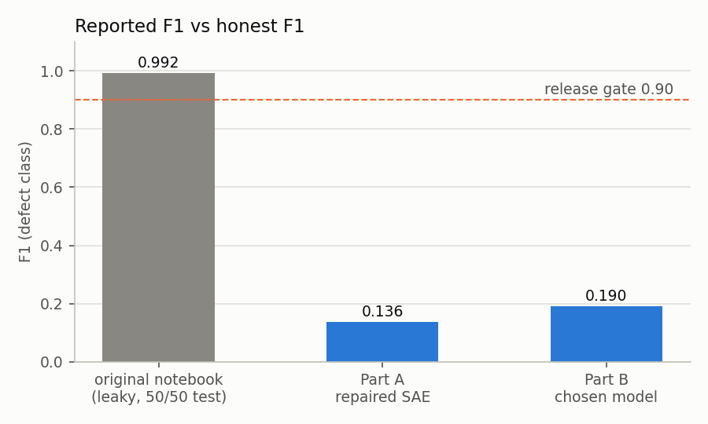
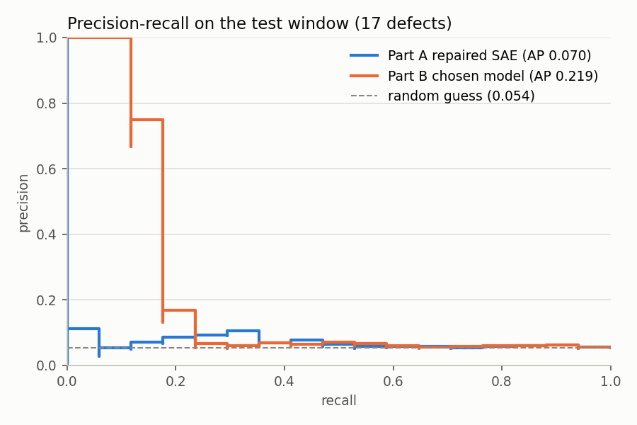

# WAFER-GUARD audit: fixing a wafer defect detector

This is my submission for the Fab-7 ML audit task. We were given a PyTorch notebook (`bnypi.ipynb`) that trains a supervised autoencoder to find defective wafers. It claimed F1 = 0.99, but that number turned out to be fake because of 3 silent bugs. I found the bugs, fixed them, and re-measured the model honestly.

**Short version:** with the bugs fixed, the real F1 at natural defect rate is about **0.14** (repaired autoencoder) and **0.19** after some careful tuning. Both are nowhere near the 0.90 release gate, so my recommendation is **don't ship it**. Details are in [AUDIT.md](AUDIT.md).



## The 3 bugs (quick summary)

1. **Data leakage.** The imputer and scaler were fit on the whole dataset, SMOTE was run before the train/test split, and the split was random in time. So the test set was full of synthetic copies of training wafers, and it was 50% defects instead of ~6.6%.
2. **Broadcasting bug in the loss.** `batch_x` had shape `[B, 1, F]` and the reconstruction had shape `[B, F]`, so `reconstructed - batch_x` quietly became a `[B, B, F]` tensor. No error, but the autoencoder was learning to output the batch average.
3. **Legacy probe station ignored.** On wafers from Probe Station PS-L, `sensor_0 = 0.0` is just a marker and `sensor_1` is an error code (100/200/300). The original treated both as real measurements, which messed up the scaling of `sensor_1` (std went from 80 to 675).

## What's in the repo

| File | What it is |
|---|---|
| `wafer_guard_fixed.ipynb` | **start here**: the fixed notebook (already run, outputs saved) |
| `AUDIT.md` | the audit write-up: the 3 bugs, evidence, final metrics |
| `wafer_utils.py` | the actual code: preprocessing, legacy handling, model, loss, metrics |
| `reproduce_bugs.py` | script that re-creates each original bug and prints the numbers |
| `tests/` | pytest tests for the fixes |
| `figures/` | the charts from the notebook |
| `secom_telemetry_modified.csv` | the dataset (1567 wafers, 590 sensors) |

The original notebook (`bnypi.ipynb`) isn't included since it came with the task.

## Setup

You need Python 3.10 or newer. No GPU needed, everything runs on CPU.

```bash
git clone https://github.com/kenthusian/wafer-guard-audit.git
cd wafer-guard-audit
python -m venv .venv
```

Activate the venv (`.venv\Scripts\activate` on Windows, `source .venv/bin/activate` on Mac/Linux), then:

```bash
pip install -r requirements.txt
```

## Running it

Open the notebook and run all cells:

```bash
jupyter notebook wafer_guard_fixed.ipynb
```

Or run it from the command line:

```bash
jupyter nbconvert --to notebook --execute --inplace wafer_guard_fixed.ipynb
```

It takes about 3 minutes on my laptop. The dataset CSV has to be in the same folder as the notebook.

To reproduce the original bugs (takes ~2 min):

```bash
python reproduce_bugs.py
```

## Settings

There are no config files. The settings are plain variables you can edit:

- **Top of `wafer_utils.py`:**
  - `LEGACY_SENTINEL` and `LEGACY_CODES`: the PS-L rule (`sensor_0 == 0.0`, codes 100/200/300).
  - `MAX_MISSING`: drop a sensor if more than 50% of the training rows are missing.
  - `MIN_MISSING_FLAG`: add a "was missing" column if at least 1% are missing.
  - `Z_CLIP`: clip scaled values at ±10.
  - `BATCH_SIZE`, `LEARNING_RATE` and `SEED`.
- **In the notebook:**
  - Section 2: the train/val/test split, 60/20/20.
  - `wu.train_sae(...)` in section 6: the model size and training length. The defaults match the original notebook.
  - `GRID` in section 8: the settings tried in the tuning round.

## Tests

```bash
pytest -q
```

The tests check:
- the legacy rule finds exactly the 146 PS-L wafers and their codes
- the error codes and the 0.0 marker never go into the mean/std used for scaling
- the preprocessor only learns from training rows (I change the test rows to garbage and check nothing changes)
- the train/val/test split is in time order
- the model rejects `[B, 1, F]` input and the loss rejects mismatched shapes
- masked (missing/placeholder) cells don't affect the reconstruction loss

The evaluator mask file (`secom_legacy_mask_EVALUATOR_ONLY.csv`) isn't in this repo. If you put it in the root folder, one extra test checks that my `sensor_0 == 0.0` rule finds exactly the same 146 wafers. Without it, that test is skipped. The pipeline itself never reads that file.

## How I fixed things

**Split by time.** I sort by timestamp and use the oldest 60% for training, the next 20% for validation, and the newest 20% for testing. The fab drifts over time (the defect rate goes from 15% down to 2%), so a random split would let the model learn from the future.

**Preprocessing only learns from train.** The `Preprocessor` class in `wafer_utils.py` learns the means, stds and medians from the training rows only, then applies them to val/test. I removed SMOTE and used `pos_weight` in the loss instead to handle the class imbalance.

**Legacy wafers.** I add an `is_legacy` column and one-hot columns for the 3 error codes. The `sensor_0` / `sensor_1` values on those wafers are left out of all the statistics. They get a placeholder of 0, but the mask makes sure the autoencoder is never trained to rebuild them.

**Shapes.** The data stays `[B, F]` the whole way. The model and the loss both have asserts, so a shape mismatch now crashes instead of silently broadcasting.

**Evaluation.** I pick the threshold on the validation set and run the test set once. I use PR-AUC as the main metric because with only ~5% defects, accuracy and ROC-AUC look good even for bad models. The test window happens to have 5.4% defects, so I also convert precision/F1 to the dataset-wide 6.6% using the model's true and false positive rates.

**Tuning (Part B).** The original-size network overfits badly. So I tried 14 settings (a smaller autoencoder, logistic regression, using only the top 60 features) using walk-forward cross-validation on the training history only. The best one by CV was logistic regression with the top 60 features. That got tested once at the end.

## Results

On the test window (314 wafers, 17 defects, 5.4% defect rate):

| Model | F1 | Precision | Recall | PR-AUC |
|---|---|---|---|---|
| Original notebook (leaky, 50/50 test set) | 0.992 | - | - | 1.000 |
| Repaired autoencoder (original settings) | 0.136 | 0.085 | 0.353 | 0.070 |
| Tuned, picked by CV (logistic regression) | 0.190 | 0.160 | 0.235 | 0.219 |
| Random guessing | - | - | - | 0.054 |



## Limitations

- There are only 104 defects in the whole dataset, and just 17 in the test window, so all of these numbers are pretty noisy.
- The defect rate changes a lot over time, so the test window doesn't sit at exactly 6.6%.
- All 146 legacy wafers in this data passed, and the model learned "legacy = pass" (it's actually its biggest weight). If a broken PS-L wafer shows up in real life, this model would probably miss it.
- The tuned model that won is logistic regression, not the autoencoder. I kept the autoencoder results too, since that's what the task asked to repair.

## Libraries used

PyTorch, scikit-learn, pandas, NumPy, joblib, imbalanced-learn (SMOTE), matplotlib, pytest, Jupyter.
